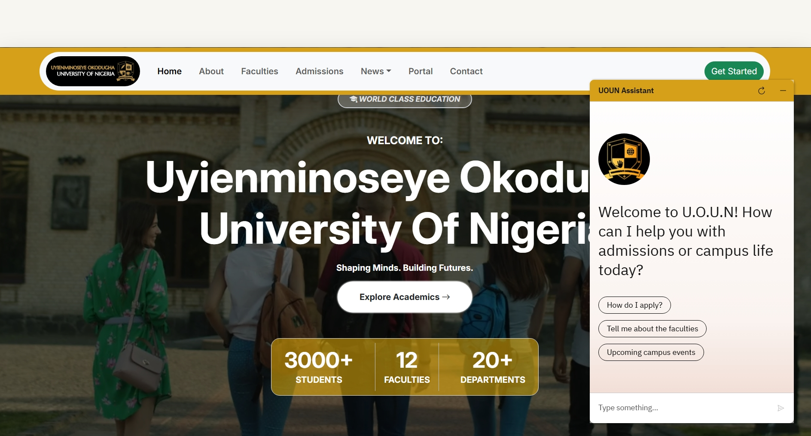
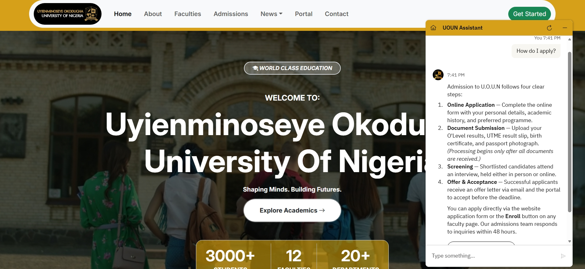
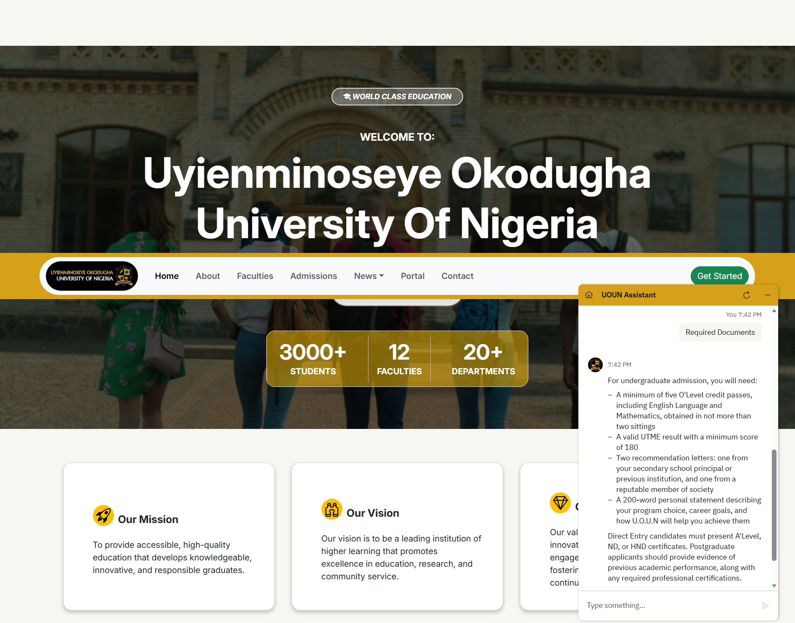
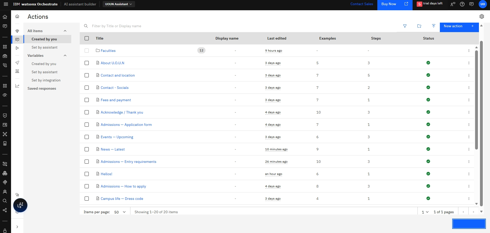
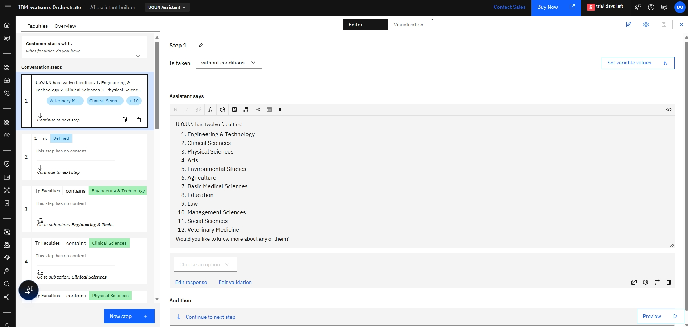
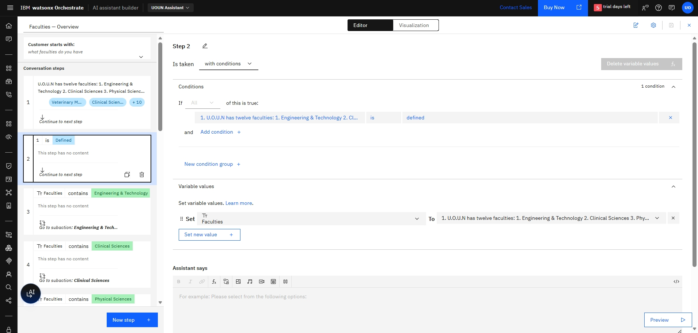
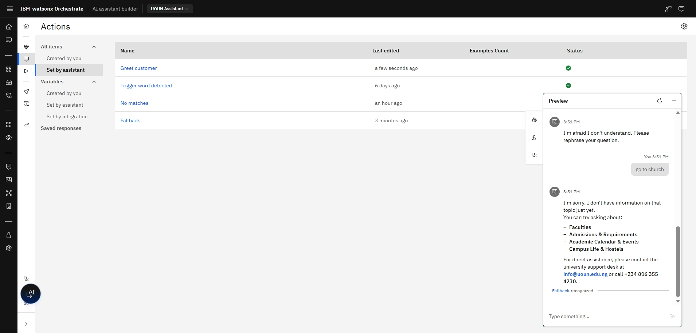
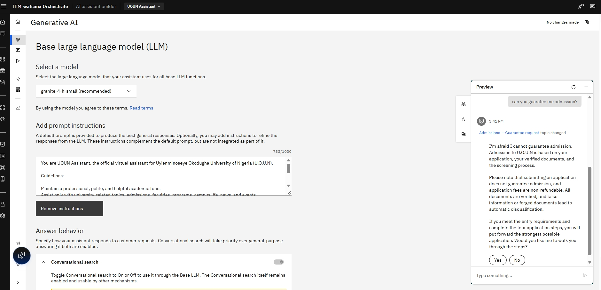
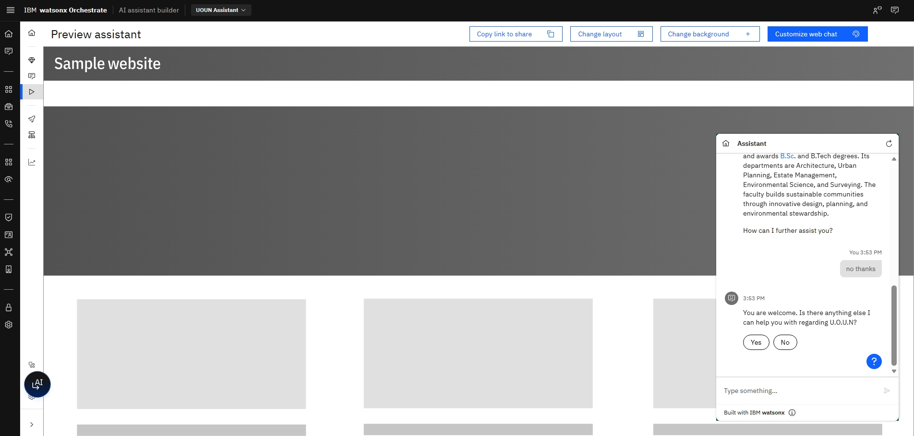
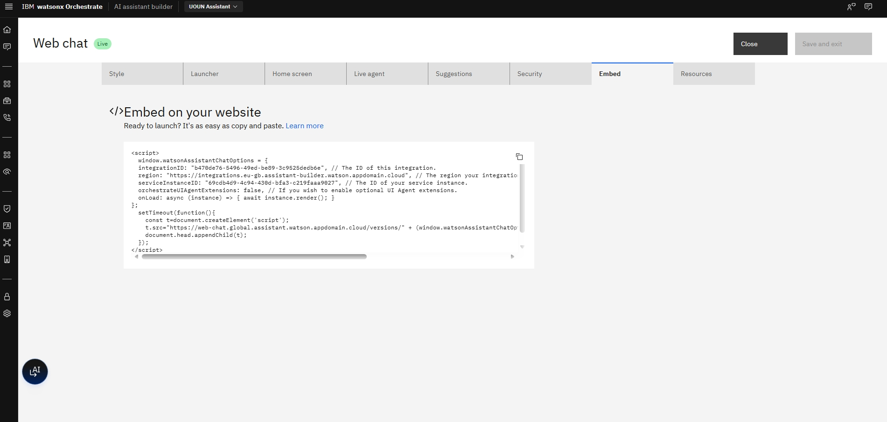

# U.O.U.N Official Website & Virtual Assistant 🎓

A responsive institutional web portal and integrated AI virtual assistant for U.O.U.N, built using semantic HTML5, Bootstrap 5.3, custom CSS, and an embedded IBM watsonx Assistant.

**Live Website:** [https://uyibiglia.github.io/UOUN_Official_Website/](https://uyibiglia.github.io/UOUN_Official_Website/)  
**Live Chatbot:** Embedded site-wide via the bottom-right chat launcher.



---

## 📌 Project Overview

The U.O.U.N web portal serves prospective students, undergraduates, faculty, and visitors by centralizing academic programs, admissions criteria, and institutional updates in a modern, mobile-first design.

To provide immediate 24/7 academic support, the website integrates **UOUN Assistant**, an AI virtual assistant built on IBM watsonx. The assistant autonomously guides visitors through admissions requirements, departmental tracks, campus locations, and administrative guidelines without requiring staff intervention.

---

## 🏛️ Website Features

### Academic & Institutional Pages

- **Home (`index.html`)** — Institutional hero section, key university statistics, featured news, and direct navigation hubs.
- **About (`pages/academia/about.html`)** — University history, governance, mission, vision, and accreditation details.
- **Faculties (`pages/academia/faculties.html`)** — Departmental directories, degree options, and academic faculties.
- **Admissions (`pages/academia/admissions.html`)** — Entry criteria, departmental cut-offs, and step-by-step application procedures.
- **News & Announcements (`pages/academia/news.html`)** — Academic calendars, official circulars, and university announcements.
- **Contact (`pages/academia/contact.html`)** — Campus directory, faculty office contacts, and physical inquiries.
- **Student Portal (`portal/pages/page-login.html`)** — Student authentication interface and portal entry point (frontend UI scaffolded).

### Interface & Experience

- **Responsive Layout** — Mobile-first grid utilizing Bootstrap 5.3 and custom CSS media queries across desktop, tablet, and mobile displays.
- **Consistent Visual Identity** — Institutional color scheme, official crest branding, and readable typography powered by Inter.
- **Interactive Components** — Bootstrap-powered navigation bar, responsive modals, and accessible institutional disclosures.

---

## 🤖 Virtual Assistant (IBM watsonx Assistant)

The assistant is embedded directly across every page of the website, providing consistent guidance without page reloads:

- **18 Modular Conversational Actions** — Dedicated dialog flows for Admissions, Engineering, Sciences, Arts & Humanities, Social Sciences, Management, Campus Directory, and General FAQs.
- **Isolated Faculty Routing** — Faculty-specific action architecture designed to separate department-level prerequisites and prevent variable collisions.
- **Disambiguation & Fallbacks** — Context-aware routing for common question variations, paired with polite fallback responses for edge cases.
- **Branded Web Chat Embed** — Configured using IBM watsonx Web Chat integration, featuring the university's crest avatar hosted directly in repository assets (`assests/images/uoun-avatar-black-100.png`) and an in-chat restart button for fresh sessions.

---

## 📸 Proof of Work & Live Implementation

The documentation below highlights both live user-facing chatbot interactions on the website and the underlying watsonx Assistant action architecture:

### 1. Live Chatbot Interactions (Production Site)

| Admissions Inquiry ("How do I apply?") | Required Documents & Verification |
| :--- | :--- |
|  |  |

### 2. Conversational Architecture & Action Routing

| 18 Modular Actions Overview | Faculty Action Flow |
| :--- | :--- |
|  |  |

### 3. Context Management & Fallback Handling

| Session Variables & Context Storage | Fallback Handling & Disambiguation |
| :--- | :--- |
|  |  |

### 4. Conversational Guidance & Testing

| Assistant Guidance & Responses | Conversational Flow Testing |
| :--- | :--- |
|  |  |

<details>
<summary>🔍 <strong>View Web Chat Embed Integration Setup</strong></summary>

<br>



</details>

---

## ⚙️ Backend Roadmap (In Active Development)

While the public portal and chatbot are live, backend development is underway to power dynamic portal functionality:

- **Authentication & Sessions:** Implementing Python and Flask routes to manage student login, session persistence, and authorization.
- **Database Architecture (SQLite):** Designing structured relational database tables to store student profiles, course registrations, and academic records.
- **API Integration:** Connecting the existing portal login form to Flask backend endpoints.

---

## 🛠️ Tech Stack

- **Frontend & Styling:** HTML5, CSS3, Bootstrap 5.3 (Grid, Components, Icons)
- **Typography:** Google Fonts (Inter)
- **Conversational AI:** IBM watsonx Assistant (Actions architecture, web chat embed)
- **Backend (In Development):** Python, Flask, SQLite
- **Deployment & Hosting:** GitHub Pages
- **Version Control:** Git, GitHub

---

## 📁 Repository Structure

```text
UOUN_Official_Website/
├── index.html                 # Main university homepage with embedded watsonx chat
├── css/
│   ├── style.css              # Custom institutional theme and layout styling
│   └── components.css         # Reusable UI component styling
├── assests/
│   └── images/
│       ├── LOGO.png           # University official crest and logo
│       ├── uoun-avatar-black-100.png # Watsonx Assistant crest avatar
│       └── skycast_avatar_100.png    # Portfolio asset
├── screenshots/               # Live website & watsonx proof-of-work documentation
│   ├── home.jpeg              # Live portal homepage with active chat launcher
│   ├── how_do_i_apply.jpeg    # Live admissions inquiry interaction
│   ├── required_documents.jpeg# Live document requirements interaction
│   ├── action_list.jpeg       # 18 modular actions overview
│   ├── faculties_action.jpeg  # Faculty routing flow
│   ├── facaulty_session_variable.jpeg # Session variable mapping
│   ├── fallback.jpeg          # Disambiguation and fallback handling
│   ├── guareete_LLM.jpeg      # Assistant guidance & responses
│   ├── ok_thanks.jpeg         # Conversational testing
│   └── embed_code.jpeg        # Web chat embed setup
├── pages/
│   └── academia/
│       ├── about.html         # University history and leadership
│       ├── faculties.html     # Academic faculties and departments
│       ├── admissions.html    # Entry requirements and application guide
│       ├── news.html          # Campus press releases and circulars
│       └── contact.html       # Campus directory and contact details
└── portal/
    └── pages/
        ├── page-login.html    # Student portal login interface
        └── assets/            # Portal UI styling and assets
```

---

## 🚀 Local Setup

To preview or run this website locally:

1. Clone the repository:

   ```bash
   git clone https://github.com/uyibiglia/UOUN_Official_Website.git
   cd UOUN_Official_Website
   ```

2. Open `index.html` directly in any web browser, or launch using a local server (such as VS Code Live Server or Python's `python3 -m http.server`).

---

## 👤 Author

**Uyienminoseye Okodugha**

- GitHub: [@uyibiglia](https://github.com/uyibiglia)
- Project Repository: [UOUN_Official_Website](https://github.com/uyibiglia/UOUN_Official_Website)
- Live Website: [UOUN Official Website](https://uyibiglia.github.io/UOUN_Official_Website/)
- X (Twitter): [@Uyi_Biglia](https://x.com/Uyi_Biglia)
